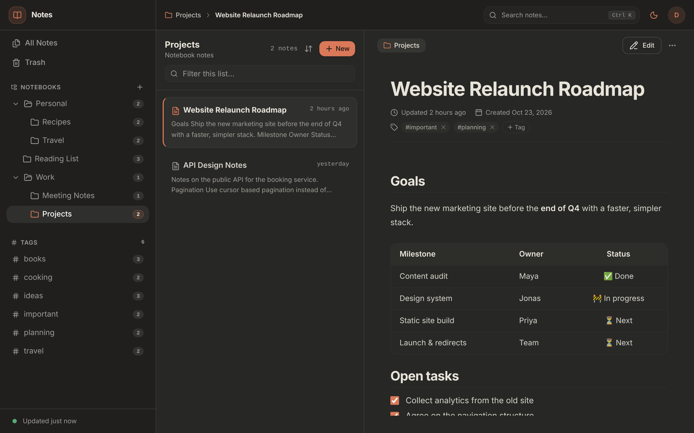
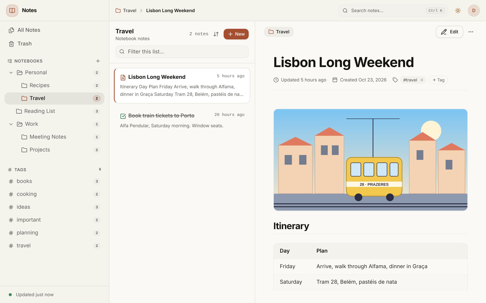
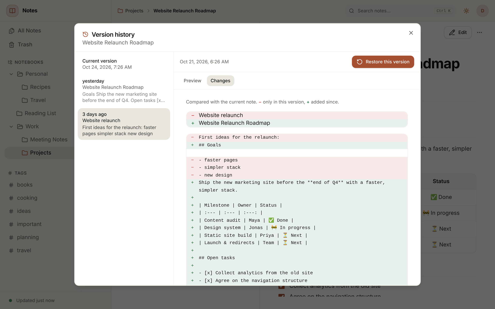
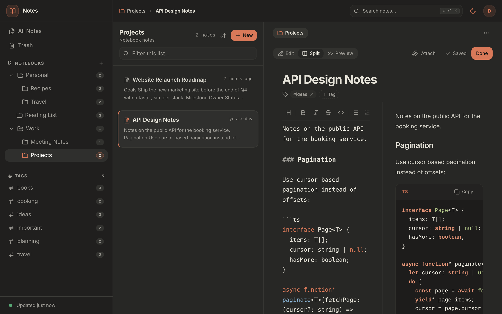
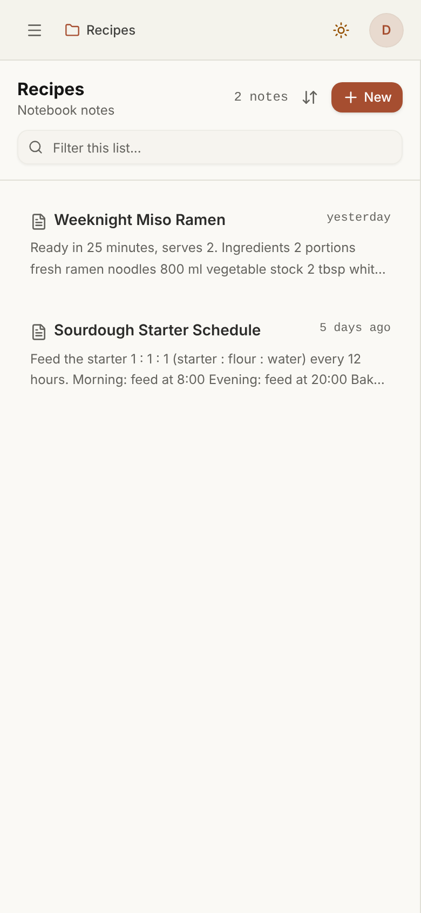
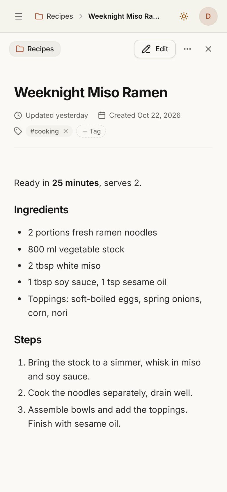

<div align="center">

# Notes

**Your Markdown notes, self-hosted, in any browser. Private by design.**

A fast, modern notes app for your home server: notebooks, tags, search, attachments, to-dos and version history.<br>
One Docker Compose stack, your own PostgreSQL, no cloud, no tracking, no third-party services.

[](https://github.com/KamiNeko/notes/actions/workflows/ci.yml)
[](https://github.com/KamiNeko/notes/actions/workflows/codeql.yml)
[](https://scorecard.dev/viewer/?uri=github.com/KamiNeko/notes)
[](LICENSE)
[](SECURITY.md)
[](docs/cra.md)
<br>
[](https://dotnet.microsoft.com)
[](https://www.postgresql.org)
[](https://react.dev)
[](https://vite.dev)
[](client/e2e)



**[Get started](#getting-started)** · **[Features](#features)** · **[Security](#security-first)** · **[Documentation](#documentation)**

</div>

## Why Notes?

Your notes are some of the most personal data you have: plans, journals, passwords you shouldn't have written down, the things you think about at 2 a.m. They don't belong on someone else's server. **Notes keeps them on yours**, and makes them as pleasant to use as any cloud app, from any browser, on any device, with nothing to install.

- 🏠 **Self-hosted, all the way.** The app and its database run in one Docker Compose stack, for example in a Proxmox LXC. Notes never calls home: no telemetry, no analytics, no external fonts or scripts.
- 🔐 **Security as a feature, not an afterthought.** Hardened defaults, a strict Content Security Policy, a locked-down container, signed releases with SBOMs, and a public security policy. Built along the EU Cyber Resilience Act. [More below.](#security-first)
- 📝 **Plain Markdown.** Notes are Markdown with the same extensions as Joplin, so notes copied over from Joplin render the same, and one click exports everything as Markdown files again. No lock-in.
- 👥 **Accounts for the household.** An administrator adds users; there is no public sign-up. Every user sees only their own notes, and not even administrators can read them in the app.
- 🕰️ **Nothing gets lost.** Version history for every note, a trash, conflict detection between devices, and unsaved typing that survives a lost connection.
- ⚡ **Fast and small.** A .NET backend and a React app in one container. A household runs comfortably on one CPU core and 1 GB of RAM.

Notes started as [Joplin Web](https://github.com/KamiNeko/joplin-web), a browser client for Joplin Server. It turned out the browser was all that was needed, so Notes keeps the same interface and drops Joplin from the setup.

Not included, on purpose: offline mode, sharing notes with others, and end-to-end encryption.

## Features

| | |
| :--- | :--- |
| 📚 **Notebooks** | Nested notebooks; create, rename, move (into another notebook or to the top level) and delete them. |
| 📝 **Markdown editor** | CodeMirror editor with *Edit*, *Split* and *Preview* modes, autosave and `Ctrl+S`. Formatting toolbar (also on phones) and shortcuts: `Ctrl+B` bold, `Ctrl+I` italic, `Ctrl+E` code, `Ctrl+K` link. Links to other notes via a search picker or *Copy Markdown link*. |
| ✨ **Rich rendering** | GitHub-flavored Markdown: tables, task lists, syntax-highlighted code blocks, plus math (KaTeX), Mermaid diagrams, `==highlight==`, `++insert++`, `~sub~` and `^sup^`. HTML notes are shown as sanitized HTML. |
| 🖼️ **Images & attachments** | Drop, paste or attach files; images are shown inline. |
| ✅ **To-dos** | Create to-dos and tick them off, right from the note list. Set, change or clear due dates; overdue to-dos are highlighted. |
| 🏷️ **Tags** | Tag notes, browse by tag, rename and delete tags. |
| 🔎 **Search** | Instant search across titles and content (`Ctrl+K`): all words must match, `"exact phrases"`, `-word` to exclude, and filters `tag:`, `notebook:`, `type:todo`, `iscompleted:0`. |
| 🕰️ **Version history** | Before an editing session changes a note, its previous state is kept as a version. Preview any version and restore it; the replaced text becomes a version too, so a restore can be undone. Optional retention period. |
| 📦 **Export** | Download all your notes as a ZIP of Markdown files with front matter, in notebook folders, with attachments and working links. Your notes are never locked in. |
| 🗑️ **Trash** | Deleted notes and notebooks go to the trash, where you can restore them or delete them permanently. |
| ⚔️ **Conflict detection** | If a note was changed in another tab or on another device while you edited it, you choose which version to keep. |
| 👥 **Users** | Administrators add accounts, reset passwords, grant the administrator role and delete users (account menu > *Manage users*). Everyone can change their own password. |
| 🛟 **No lost typing** | Unsaved text is kept on the device while offline or after the session expires, saves retry when the connection returns, and you can restore a draft later. |
| 🌗 **Light & dark mode** | Switch themes with one click. |
| 📱 **Responsive** | Works on phones and tablets as well as on the desktop. |

## Security first

Notes is meant to be reachable from the internet, so it is built like it will be attacked.

| | |
| :--- | :--- |
| 🔑 **Accounts** | Passwords hashed with PBKDF2-HMAC-SHA512 (210,000 iterations), 12 characters minimum (NIST SP 800-63B). Rate limits per address and an account lock after 10 failed sign-ins. Unknown accounts look exactly like wrong passwords. |
| 🍪 **Sessions** | Server-side sessions, stored only as hashes. `HttpOnly`, `SameSite=Strict`, `Secure` `__Host-` cookie over HTTPS. 30 days idle, 90 days at most; a password change signs out your other devices. |
| 🛡️ **Browser** | Strict Content Security Policy without inline scripts, sanitized Markdown and HTML, CSRF protection by Origin check, HSTS, `frame-ancestors 'none'`, no caching of API answers. Risky attachments are always downloads. |
| 🧱 **Isolation** | Every query is scoped to the signed-in user, covered by tests. The container runs as non-root with a read-only filesystem, no Linux capabilities and `no-new-privileges`; the database is never published. |
| 📜 **Audit trail** | Sign-ins, failures, locks, password and account changes and refused requests go to a security log with stable event ids, without passwords or tokens. |
| 📦 **Supply chain** | Lock files for every dependency, base images pinned by digest, GitHub Actions pinned by commit. CodeQL, dependency review, NuGet and npm audit and an image scan on every change; Dependabot for updates. Releases come with SBOMs and signed build provenance you can verify with `gh attestation verify`. |
| 🇪🇺 **CRA** | Every essential requirement of the EU Cyber Resilience Act is mapped to how Notes meets it, gaps included: [CRA compliance](docs/cra.md). As a free, non-commercial project Notes is outside the CRA's scope and follows it voluntarily. |

Found a vulnerability? Please report it privately, as described in the [security policy](SECURITY.md). Running Notes on the internet? Read the [security guide](docs/security.md) and its hardening checklist first.

## Screenshots

<table>
  <tr>
    <td colspan="2"></td>
  </tr>
  <tr>
    <td colspan="2" align="center"><em>Light mode, with an image attachment</em></td>
  </tr>
  <tr>
    <td colspan="2"></td>
  </tr>
  <tr>
    <td colspan="2" align="center"><em>Version history: preview an earlier state and restore it</em></td>
  </tr>
  <tr>
    <td colspan="2"></td>
  </tr>
  <tr>
    <td colspan="2" align="center"><em>Split-view editor with live preview</em></td>
  </tr>
  <tr>
    <td align="center"></td>
    <td align="center"></td>
  </tr>
  <tr>
    <td colspan="2" align="center"><em>On a phone</em></td>
  </tr>
</table>

## Getting started

You need a Linux host with **Docker** and the Docker Compose plugin. In a Proxmox LXC, enable *nesting* (and *keyctl*) under Options > Features and install Docker inside it.

```bash
git clone https://github.com/KamiNeko/notes.git
cd notes
cp .env.example .env && chmod 600 .env
# Edit .env: POSTGRES_PASSWORD (openssl rand -hex 24), NOTES_ADMIN_EMAIL, NOTES_ADMIN_PASSWORD (12+ characters)
docker compose up -d --build
```

Open `http://<host>:8080` and sign in with the administrator account from `.env`. It is created on the first start; afterwards remove `NOTES_ADMIN_PASSWORD` from `.env`. Add more users in the app (account menu > *Manage users*).

The stack has two containers: `notes` (the app, port 8080) and `notes-db` (PostgreSQL 17, not published). Attachments live in the `notes-files` volume, everything else in the database (`notes-db` volume).

> [!IMPORTANT]
> Put Notes behind a reverse proxy with **HTTPS** (Caddy, Traefik, Nginx Proxy Manager, …) before you use it outside your home network, and set `NOTES_PUBLIC_URL` and `NOTES_TRUST_PROXY=true`. The [deployment guide](docs/deployment.md) has ready-to-use proxy configurations.

Released versions are also published as signed multi-arch images (`ghcr.io/kamineko/notes:<version>`); see [using the published image](docs/deployment.md#using-the-published-image-instead-of-building). Updating, backups, restore, the command line and removing Notes are all covered in the [deployment guide](docs/deployment.md).

### Configuration

Settings go into `.env`; `docker-compose.yml` passes them to the app. Every app setting can also be set directly as `Notes__<Name>` (ASP.NET Core configuration).

| `.env` | App setting | Default | Meaning |
| :--- | :--- | :--- | :--- |
| `POSTGRES_PASSWORD` | | (required) | Password of the database user `notes`. |
| `NOTES_ADMIN_EMAIL`, `NOTES_ADMIN_PASSWORD` | `Notes__Admin__Email`, `Notes__Admin__Password` | | First administrator, created while there are no users yet. |
| `HOST_PORT` | | `8080` | Host port the app is published on, e.g. `127.0.0.1:8080` to reach it only through a local proxy. |
| `NOTES_PUBLIC_URL` | `Notes__PublicUrl` | | The URL you open, e.g. `https://notes.example.com`. Allowed as request origin; with `https://` the session cookie is `Secure`. |
| `NOTES_TRUST_PROXY` | `Notes__TrustProxy` | `false` | Trust `X-Forwarded-For/-Proto/-Host` from a reverse proxy. |
| `NOTES_TRUSTED_PROXIES` | `Notes__TrustedProxies` | private networks | Addresses or CIDR ranges the proxy connects from (comma-separated). Only needed when it isn't on a private network. |
| `NOTES_VERSION_RETENTION_DAYS` | `Notes__VersionRetentionDays` | `0` | Delete versions older than this many days (`0` keeps all). |
| `NOTES_MAX_UPLOAD_MB` | `Notes__MaxUploadMb` | `25` | Largest attachment. |
| `NOTES_ALLOW_REMOTE_IMAGES` | `Notes__AllowRemoteImages` | `false` | Show `https:` images from other websites in notes. Off by default because each remote image tells its host who opened the note. |
| | `Notes__VersionIntervalMinutes` | `10` | Edits within this many minutes of the last version don't create another one. |
| | `Notes__SessionLifetimeDays`, `Notes__SessionMaxAgeDays` | `30`, `90` | A session ends after this many days without use, and at the latest this many days after sign-in. |
| | `Notes__LoginMaxFailures` | `10` | Failed sign-ins within 15 minutes that lock an account for 15 minutes. |
| | `Notes__CookieSecure` | `auto` | `auto` (Secure over HTTPS), `true` or `false`. |
| | `Notes__RateLimitMax`, `Notes__LoginRateLimitMax` | `1000`, `30` | API requests and sign-in attempts per client address and 15 minutes. |

## Moving from Joplin, and away from Notes

**From Joplin:** Notes uses the same Markdown dialect, including links to other notes and attachments written as `:/<32-character id>`. Copying a note's Markdown from Joplin into a new note keeps its formatting. Links to other notes only work once those notes exist here with their ids, and attachments need to be added again. There is no automatic importer yet.

**Away from Notes:** account menu > *Export notes* downloads all your notes as a ZIP: one Markdown file per note with YAML front matter (title, dates, tags, to-do state), folders per notebook, attachments in `_resources/`, and links rewritten to relative paths. Joplin's *Markdown + Front Matter* import, Obsidian and most Markdown editors open it directly.

## Documentation

| | |
| :--- | :--- |
| [Deployment guide](docs/deployment.md) | Install (also on Proxmox), reverse proxy and HTTPS, updates, backup and restore, command line, removing Notes, troubleshooting |
| [Security guide](docs/security.md) | Security model, what Notes defends against and what not, hardening checklist, security log, data protection |
| [Security policy](SECURITY.md) | Supported versions, how to report a vulnerability, response times, verifying releases |
| [CRA compliance](docs/cra.md) | How Notes meets the EU Cyber Resilience Act requirement by requirement |
| [Architecture (arc42)](docs/architecture/README.md) | Goals, context, building blocks, runtime, deployment, concepts, decisions, quality scenarios, risks, glossary |
| [Changelog](CHANGELOG.md) | What changed in each version, including breaking changes |

## Development

Everything needed (the .NET 10 SDK, Node.js 24, PostgreSQL 17) comes with the **dev container**: open the folder in VS Code (from WSL too) and choose *Reopen in Container*. Without it, install those three yourself and create a database user `notes` with password `notes`.

```bash
# Backend: API on http://localhost:5080, Development settings seed a demo account
dotnet run --project backend/src/Notes.Api

# Client: http://localhost:5173, proxies /api to the backend
npm --prefix client run dev
```

Demo login: `demo@notes.test` / `demo-password`.

```text
backend/   .NET 10 API (minimal APIs, EF Core, PostgreSQL) and its integration tests
client/    React app (Vite, Tailwind, shadcn/ui, TanStack Query, CodeMirror 6)
  e2e/     Playwright smoke tests
docker/    Production Dockerfile
docs/      Guides, arc42 architecture, screenshots
```

| Command | |
| :--- | :--- |
| `cd backend && dotnet test` | Backend integration tests (each test class gets its own database, `NOTES_TEST_DATABASE`) |
| `npm --prefix client run lint` / `test` / `build` | Client lint, unit tests (Vitest), production build |
| `npm --prefix client run test:e2e` | Playwright smoke tests; starts backend and client itself (`E2E_DATABASE`) |
| `npm --prefix client run screenshots` | README screenshots into `docs/images` (backend and client must run) |

CI runs all of these on every pull request, plus the security checks above and a Docker image build. [`CLAUDE.md`](CLAUDE.md) describes the conventions for contributors and AI assistants alike.

## License

[MIT](LICENSE)
