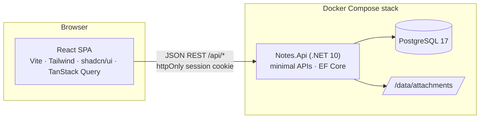

# Architecture

Notes is a React SPA and a .NET 10 backend with its own PostgreSQL database. The client came from [Joplin Web](https://github.com/KamiNeko/joplin-web) and still speaks the same small JSON REST API; the backend behind it no longer translates to Joplin's sync protocol but stores everything itself.

In production the backend also serves the compiled client from `wwwroot`. Content-hashed files under `/assets/` are sent with `Cache-Control: public, max-age=31536000, immutable`; `index.html` (also the SPA fallback for every non-`/api` path) and other files with `no-cache`, so a new release is picked up on the next load. Unknown `/api` paths answer a JSON 404.

## Backend (`backend/src/Notes.Api`)

| Folder | Responsibility |
| :--- | :--- |
| `Program.cs` | DI, Kestrel limits, forwarded headers (`TrustProxy`), middleware order, startup (migrate, first admin, demo seed). The `healthcheck` and `users` arguments run CLI commands instead of the server. |
| `Data/` | Entities, `NotesDbContext` (snake_case names via EFCore.NamingConventions), migrations, the demo seed (`DemoSeed.json`, `DemoSeeder`). |
| `Auth/` | `UserService` (accounts, passwords via ASP.NET Core Identity's `PasswordHasher`), `SessionService` (server-side sessions), the `Session` authentication scheme and cookies. |
| `Services/` | One service per resource: `NotebookService`, `NoteService`, `VersionService`, `TagService`, `SearchService` (+ `SearchQuery` parser), `ResourceService`; `TextPreview` (list previews from Markdown/HTML), `Dtos.cs` (the JSON shapes), `VersionPruning` (background retention job). |
| `Endpoints/ApiEndpoints.cs` | All routes as minimal APIs. Handlers are thin: parse, call a service, return a DTO. |
| `Infrastructure/` | `NotesOptions`, `ApiException` (→ JSON error), `Ids`, `Times`, middleware (errors, Origin check, security headers), rate limits. |
| `Cli/` | `users list|add|set-password`, `healthcheck`. |

Every query is filtered by the signed-in user's id (`ClaimsPrincipal.UserId()`), and services look items up with `(userId, id)`, so one user can never read or change another user's items; a foreign id is a 404.

### Data model

| Table | Notes |
| :--- | :--- |
| `users` | Email (unique, lower-cased), display name, password hash, `is_admin`. Deleting a user cascades to everything below and removes their attachment folder. |
| `sessions` | SHA-256 hash of the token (the token itself is only in the cookie), `expires_time`, `last_used_time`. |
| `notebooks` | Tree through `parent_id`; `deleted_time` for the trash. |
| `notes` | Title, Markdown (or HTML, `markup_language = 2`) body, cached `preview`, to-do fields, `deleted_time`. Trigram GIN indexes on title and body (`pg_trgm`) for search. |
| `tags`, `note_tags` | Tag titles are unique per user, case-insensitively (index on `lower(title)`). |
| `resources` | Attachment metadata; the file is `DataDirectory/attachments/<userId>/<id>`. |
| `note_versions` | Earlier title + body of a note with the note's `updated_time` back then. |

Ids are 32 lowercase hex characters (`Guid.ToString("N")`), the same shape as Joplin's, so `:/<id>` links in Markdown work for notes and attachments. Times are Unix milliseconds in the API and `timestamptz` (truncated to whole milliseconds) in the database.

### Sessions and security

- `POST /api/auth/login` checks the password and creates a session: 32 random bytes, stored as a hash. The cookie is `__Host-notes_session` over HTTPS or `notes_session` (path `/api`) over HTTP; HttpOnly, SameSite=Strict. API clients can send `Authorization: Bearer <token>` instead (login returns `sessionId` when the request has no `Origin`).
- Sessions slide: each use extends them to `SessionLifetimeDays` (written at most every 5 minutes). Changing a password ends the user's other sessions; an admin's password reset ends all of them.
- `OriginCheckMiddleware`: POST/PUT/DELETE under `/api` must come from the request's own origin or `PublicUrl`. Requests without `Origin` pass only without the cookie (non-browser clients).
- `SecurityHeadersMiddleware`: the same CSP as Joplin Web (`script-src 'self'`, images from `'self' data: blob:`, plus `https:` with `AllowRemoteImages`), `nosniff`, `no-referrer`, frame denial.
- Rate limits per client address and 15 minutes: `RateLimitMax` for the API, `LoginRateLimitMax` for logins; 429 with `Retry-After`.
- Attachments are served with `nosniff`, a sandboxing CSP, and as downloads unless they are images that are safe inline (SVG and HTML are always downloads).
- Errors are JSON `{ error, status, details? }`; 5xx responses carry a generic message only.

### Rules the services keep

- **Conflict detection.** Note updates (and version restores) take `baseUpdatedTime`; when the note changed since, the answer is 409 with `details.current` (the stored note), which the client's conflict dialog shows.
- **Trash.** Trashing a notebook stamps it and everything below with the same `deleted_time`. Restoring brings back exactly the items with that stamp (plus trashed ancestors, so a restored item is reachable). Purging deletes the subtree with its notes, their tag links and versions.
- **Notebook moves** refuse cycles (a notebook into its own subtree).
- **Versions.** Before a title or body change, `VersionService.SnapshotBeforeChangeAsync` stores the previous content, unless the newest version is younger than `VersionIntervalMinutes` (an editing session's autosaves produce one version), the note was empty, or the content equals the newest version. Restoring a version always snapshots first, so it can be undone. `VersionPruning` deletes versions older than `VersionRetentionDays` once a day (0 = keep).
- **Search** parses Joplin's syntax (words, `"phrases"`, `-negation`, `tag:`, `notebook:` (including sub-notebooks), `type:`, `iscompleted:`, `*` wildcards). Words become `ILIKE` filters in SQL (escaped, backed by the trigram indexes); ranking (title hits first, then recency) and snippets are computed in C# on at most 500 results.

## REST API

All routes except `/api/health` and `/api/auth/login` need a session. Bodies and answers are JSON (camelCase).

| Route | |
| :--- | :--- |
| `GET /api/health` | `{ status, version, commit }` |
| `POST /api/auth/login` · `POST /api/auth/logout` · `GET /api/auth/check` · `POST /api/auth/password` | Sign in (`{ email, password }` → `{ userId, user }`), sign out, current user (`{ valid, user }`), change own password (`{ currentPassword, newPassword }`) |
| `GET /api/notebooks` · `GET /api/notebooks/trash` · `POST /api/notebooks/refresh` | Tree with note counts and `counts` (all/trash), trashed notebooks, the tree again (the client's *Refresh*) |
| `POST /api/notebooks` · `PUT /api/notebooks/{id}` · `DELETE /api/notebooks/{id}[?permanent=true]` · `POST /api/notebooks/{id}/restore` | Create, rename/move, trash or purge, restore |
| `GET /api/notes?notebookId=&tagId=&isTrash=` | Note list (previews, no bodies) |
| `GET/POST/PUT/DELETE /api/notes[/{id}]` · `POST /api/notes/{id}/restore` | Read, create, update (`baseUpdatedTime`), trash or purge, restore |
| `POST /api/notes/{id}/tags` · `DELETE /api/notes/{id}/tags/{tagId}` | Tag by title (reuses an existing tag), untag |
| `GET /api/notes/{id}/versions` · `GET /api/notes/{id}/versions/{versionId}` · `POST …/restore` | Version list, one version with body, restore (`{ baseUpdatedTime }`) |
| `GET /api/tags` · `PUT /api/tags/{id}` · `DELETE /api/tags/{id}` | Tags with counts, rename, delete |
| `GET /api/search?q=` | Results with `matches { inTitle, inBody, snippet, terms }` |
| `POST /api/resources` · `GET /api/resources/{id}` · `DELETE /api/resources/{id}` | Upload (raw body, `X-File-Name` URI-encoded, `X-File-Type`), download, delete |
| `GET/POST /api/admin/users` · `PUT/DELETE /api/admin/users/{id}` | Administrators only: list, create, change (name, role, password), delete. The last administrator can't be demoted or deleted. |

## Client (`client/src`)

Unchanged in structure from Joplin Web: `lib/api.ts` (fetch wrapper with session-expiry handling), `hooks/` (TanStack Query hooks, mutations invalidate the affected queries), `components/` (layout, notes, notebooks, tags, `account/` for the password and user dialogs), `pages/`. Drafts of unsaved edits are kept in `localStorage` per account (`lib/drafts.ts`). The Joplin-specific parts are gone: conflict copies, the E2EE/read-only state and the server host.

The UI code has no backend specifics beyond `lib/api.ts`, so it can later move into a shared UI library.

## Tests

- `backend/tests/Notes.Api.Tests`: xUnit v3 on Microsoft Testing Platform. `NotesApiFactory` (WebApplicationFactory) creates a fresh PostgreSQL database per test class (`NOTES_TEST_DATABASE`) and uses a `FakeTimeProvider`, so version intervals and session expiry are tested without waiting.
- `client`: Vitest + Testing Library with a stubbed `fetch` (`src/test/fetch-mock.ts`).
- `client/e2e`: Playwright smoke tests against the real backend with the demo account (`playwright.config.ts` starts `dotnet run` on its own database, `E2E_DATABASE`).
