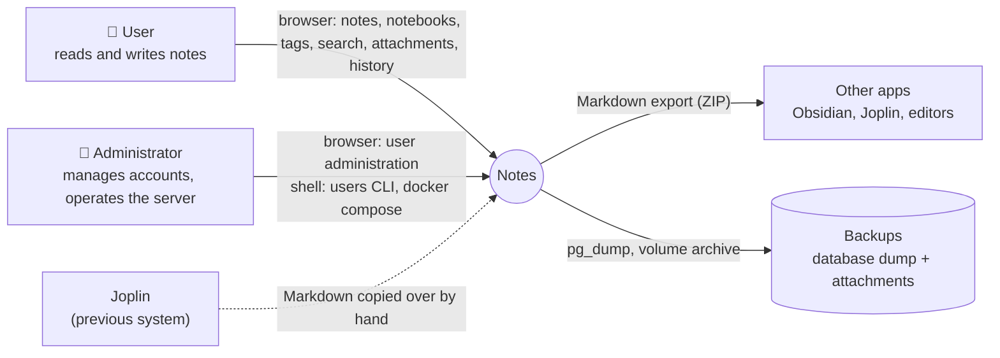
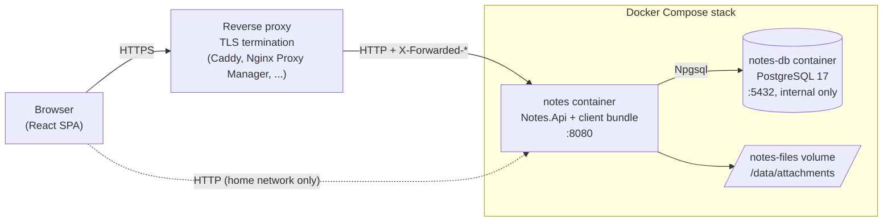

# 3. Context and scope

## Business context

| Partner | Input to Notes | Output from Notes |
| :--- | :--- | :--- |
| User | Credentials, notes, attachments, search queries | Rendered notes, lists, search results, attachments, the export ZIP |
| Administrator | New accounts, password resets, roles; configuration in `.env` | Account list, security log |
| Joplin | Markdown text pasted into new notes | – |
| Other apps | – | Export: Markdown with YAML front matter, attachments, relative links |
| Backup system | – | Database dump and attachment archive |

## Technical context

| Interface | Technology | Notes |
| :--- | :--- | :--- |
| Web UI and REST API | HTTP on port 8080, JSON under `/api`, static files otherwise | Session cookie (browser) or `Authorization: Bearer` (API clients). See [section 5](05-building-block-view.md#rest-api). |
| Reverse proxy | `X-Forwarded-For`, `-Proto`, `-Host` | Only honoured with `Notes__TrustProxy` and only from `Notes__TrustedProxies`. |
| Database | PostgreSQL protocol (Npgsql), connection string `ConnectionStrings__Notes` | Not published outside the Compose network. |
| File storage | Local filesystem, `Notes__DataDirectory` (`/data` in the container) | Attachments and temporary export files. |
| Command line | `dotnet Notes.Api.dll users …`, `… healthcheck` | Run inside the container with `docker compose exec`. |
| Logs | Console (stdout), read by Docker | Security events under the category `Notes.Security`. |

There are no outgoing connections: no telemetry, no update checks, no external services.
