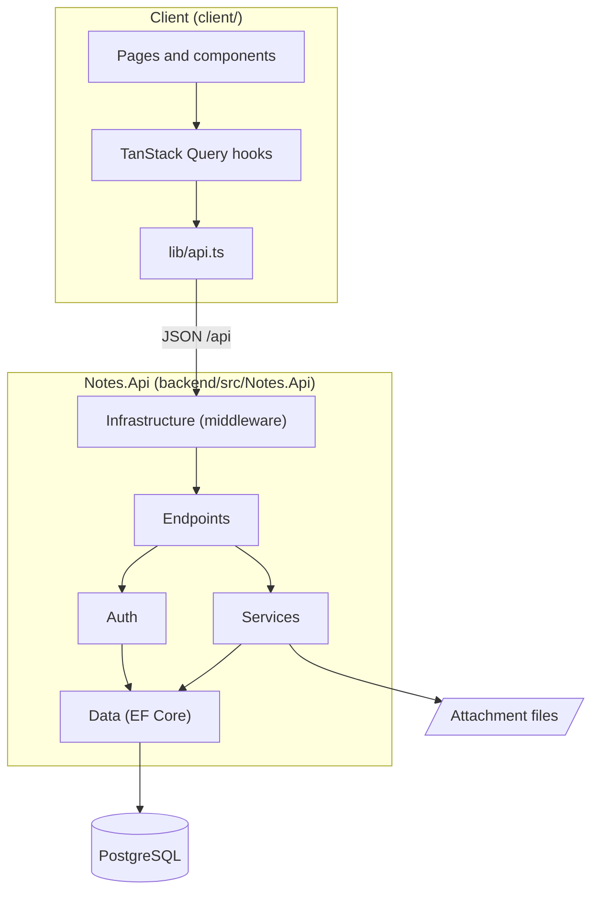
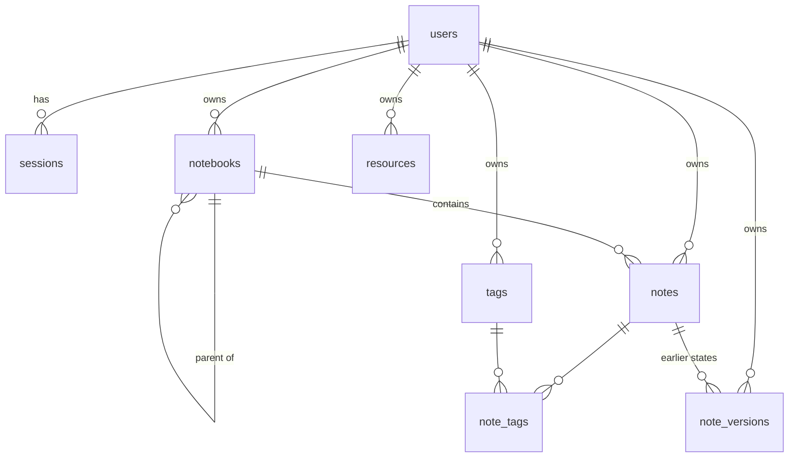

# 5. Building block view

## Level 1: the whole system

| Building block | Responsibility |
| :--- | :--- |
| Client | The user interface. Holds no data of its own except drafts and view settings in `localStorage`. |
| Notes.Api | Authentication, authorization, all business rules, storage, serving the compiled client. |
| PostgreSQL | Users, sessions, notebooks, notes, tags, attachment metadata, versions. |
| Attachment files | File contents under `DataDirectory/attachments/<userId>/<resourceId>`. |

## Level 2: Notes.Api

| Folder | Responsibility |
| :--- | :--- |
| `Program.cs` | Dependency injection, Kestrel limits, forwarded headers, the middleware order, startup (migrations, first administrator, demo seed, cleanup). The arguments `healthcheck` and `users …` run CLI commands instead of the server. |
| `Endpoints/ApiEndpoints.cs` | All routes as minimal APIs. Handlers only parse, call a service and return a DTO. |
| `Auth/` | `UserService` (accounts, passwords), `SessionService` (server-side sessions), `SessionCookies`, `SessionAuthenticationHandler` (the `Session` scheme), `LoginThrottle` (account lock). |
| `Services/` | One service per resource: `NotebookService`, `NoteService`, `VersionService`, `TagService`, `SearchService` (with the `SearchQuery` parser), `ResourceService` (with `ResourceTypes`), `ExportService`. Plus `TextPreview` (list previews), `Titles`, `Dtos.cs` (all JSON shapes) and `VersionPruning` (background job). |
| `Data/` | Entities, `NotesDbContext`, migrations, the demo seed (`DemoSeed.json`, `DemoSeeder`). |
| `Infrastructure/` | `NotesOptions`, `ApiException`, `Ids`, `Times`, middleware (errors, Origin check, security headers), `RateLimits`, `TrustedProxies`, `SecurityLog`. |
| `Cli/` | `UserCommands` (`users list|add|set-password`), `HealthCheck`. |

Middleware order: forwarded headers (if trusted) → security headers → error handling → rate limiter → Origin check → static files → authentication → authorization → endpoints → `/api` 404 → SPA fallback (`index.html`).

## Level 2: client

| Folder | Responsibility |
| :--- | :--- |
| `src/lib/` | `api.ts` (the only module that knows the backend: fetch wrapper, session expiry, all calls), `types.ts`, `drafts.ts`, `connection.ts`, formatting and Markdown helpers. |
| `src/hooks/` | TanStack Query hooks per resource; mutations update or invalidate the affected queries. `use-auth.ts` holds the session state. |
| `src/components/` | `layout/` (header, sidebar, connection status), `notes/` (list, viewer, editor, history), `notebooks/`, `tags/`, `account/` (password and user dialogs), `common/` (Markdown renderer, dialogs), `ui/` (generated shadcn/ui). |
| `src/pages/` | `LoginPage`, `NotesPage` (all note routes). |

## Data model

| Table | Content |
| :--- | :--- |
| `users` | Email (unique, lower-cased), display name, password hash, `is_admin`, `quota_mb` (storage limit; null uses `Notes__QuotaMb`, 0 is unlimited). Deleting a user cascades to all their rows; the service also removes their attachment folder. |
| `sessions` | SHA-256 hash of the token, created, last seen and expiry time. |
| `notebooks` | Tree through `parent_id`; `deleted_time` for the trash. |
| `notes` | Title, body (Markdown, or HTML with `markup_language = 2`), cached `preview`, to-do fields, `deleted_time`. Trigram GIN indexes on title and body. |
| `tags`, `note_tags` | Tag titles are unique per user, ignoring case (index on `lower(title)`). |
| `resources` | Attachment metadata (file name, MIME type, size). |
| `note_versions` | Earlier title and body of a note, with the note's `updated_time` at that point. |

Ids are 32 lowercase hex characters (`Guid.ToString("N")`). Times are Unix milliseconds in the API and `timestamptz`, truncated to whole milliseconds, in the database.

## REST API

All routes except `/api/health` and `/api/auth/login` need a session. Bodies and answers are JSON with camelCase names, ids are 32 hex characters and times Unix milliseconds. Errors are `{ error, status, details? }`.

**API clients** (scripts, other apps) sign in without an `Origin` header: the login answer then also carries `sessionId`, which they send as `Authorization: Bearer <sessionId>`. Browsers never get the token in the body, only the `HttpOnly` cookie. Writes without `Origin` are only accepted when they don't carry the session cookie (see [Request protection](08-crosscutting-concepts.md#request-protection)).

| Route | |
| :--- | :--- |
| `GET /api/health` | `{ status, version, commit }` |
| `POST /api/auth/login` · `POST /api/auth/logout` · `GET /api/auth/check` · `POST /api/auth/password` | Sign in (`{ email, password }` → `{ userId, user }`, plus `sessionId` for API clients; 401 wrong credentials, 429 locked), sign out, current user (`{ valid, user }`), change own password (`{ currentPassword, newPassword }` → 204; 400 wrong current password) |
| `GET /api/notebooks` · `GET /api/notebooks/trash` · `POST /api/notebooks/refresh` | Tree of active notebooks (`{ id, title, parentId, children, noteCount, createdTime, updatedTime }[]`, `noteCount` counts direct notes), trashed notebooks (the top of each trashed subtree with `noteCount`, `notebookCount` and `earlierNoteCount`), the tree again (the client's *Refresh*) |
| `POST /api/notebooks` · `PUT /api/notebooks/{id}` · `DELETE /api/notebooks/{id}[?permanent=true]` · `POST /api/notebooks/{id}/restore` | Create (`{ title, parentId? }` → 201), rename/move (`parentId: ""` moves to the top level; 400 for a move into itself), trash, purge (only from the trash, else 409), restore (409 when not in the trash). Trash, purge and restore answer the affected `{ notebooks, notes }` counts |
| `GET /api/notes?notebookId=&tagId=&isTrash=` | Note list (previews, no bodies) |
| `GET/POST/PUT/DELETE /api/notes[/{id}]` · `POST /api/notes/{id}/restore` | Read, create (`{ parentId, title?, body?, isTodo? }` → 201), update (`title`, `body`, `parentId`, `todoCompleted`, `todoDue`; `baseUpdatedTime` → 409 with `details.current` on conflict unless `force`), trash or purge (`?permanent=true`, only from the trash) → 204, restore (with its trashed notebooks) |
| `POST /api/notes/{id}/tags` · `DELETE /api/notes/{id}/tags/{tagId}` | Tag by title (reuses an existing tag), untag |
| `GET /api/notes/{id}/versions` · `GET /api/notes/{id}/versions/{versionId}` · `POST …/restore` | Version list, one version with body, restore (`{ baseUpdatedTime }`) |
| `GET /api/tags` · `PUT /api/tags/{id}` · `DELETE /api/tags/{id}` | Tags with counts of active notes, rename (409 when the title is taken, case-insensitively), delete (→ `{ notes }`, how many notes had it) |
| `GET /api/search?q=` | Results with `matches { inTitle, inBody, snippet, terms }` |
| `POST /api/resources` · `GET /api/resources/{id}` · `DELETE /api/resources/{id}` | Upload (raw body; `X-File-Name` URI-encoded, `X-File-Type`), download, delete |
| `GET /api/export` | ZIP of all active notes as Markdown with attachments |
| `GET /api/storage` | `{ usedBytes, quotaBytes }`: space the user's attachments take and their limit (`null`: unlimited). Uploads past the limit get 413 with `details: { usedBytes, quotaBytes }`. |
| `GET/POST /api/admin/users` · `PUT/DELETE /api/admin/users/{id}` | Administrators only: list (with `quotaMb` and `usedBytes`), create, change (name, role, password, storage limit via `quotaMb` or `resetQuota`), delete. The last administrator can't be demoted or deleted; nobody can delete their own account. |
