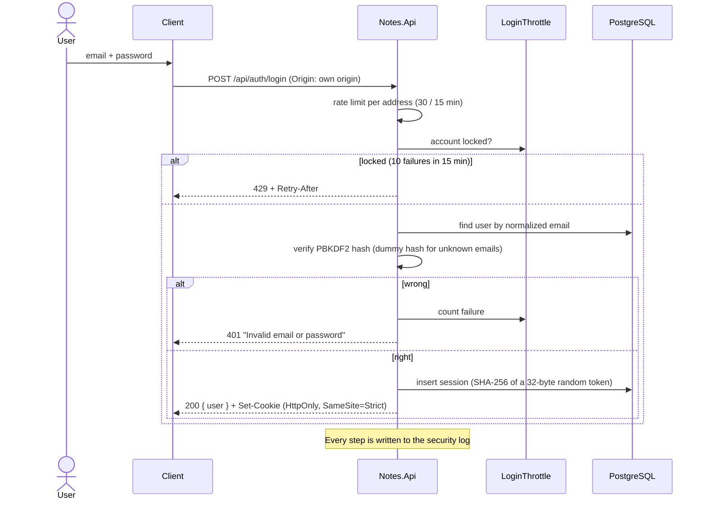
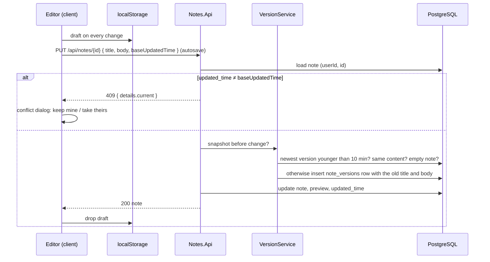

# 6. Runtime view

## Sign-in

Every later request carries the cookie. `SessionAuthenticationHandler` looks up the token hash, checks expiry (30 days without use, 90 days at most) and loads the user with their current role. Every few minutes of use it moves the expiry ahead and renews the cookie.

## Editing a note

One editing session (autosaves less than `VersionIntervalMinutes` apart) produces one version: the state before the session started. Restoring a version (`POST …/versions/{id}/restore`) always snapshots the current state first, so a restore can be undone.

If a save fails because the server is unreachable, the draft stays in `localStorage` and the save is retried when the connection returns. If the session expired, a dialog offers to sign in again; the draft is offered for restore afterwards.

## Attachments

1. The editor uploads a dropped or pasted file with `POST /api/resources` (raw body, name and type in headers) and inserts `` or `[name](:/<id>)`.
2. `ResourceService` writes it to a temporary file, detects the MIME type (declared type, extension, then magic bytes) and moves it to `attachments/<userId>/<id>`.
3. The renderer finds `:/<id>` links, loads `GET /api/resources/<id>` with the session and shows it through a `blob:` URL (SVG as a `data:` URL, so opening it can't run scripts). Downloads keep their original file name.

## Search

1. The client sends `GET /api/search?q=…` while typing (debounced).
2. `SearchQuery` parses words, phrases, negations and filters (`tag:`, `notebook:`, `type:`, `iscompleted:`).
3. `SearchService` filters in SQL (`ILIKE` with escaped patterns, using the trigram indexes, plus joins for tags and notebook subtrees), loads at most 500 candidates, ranks them (title hits first, then recency) and builds snippets with the matched terms.

## Export

`GET /api/export` → `ExportService` loads the user's active notebooks, notes with tags, and attachments, computes unique, filesystem-safe paths (`Notebook/Sub/Note.md`, `_resources/file.png`), writes a ZIP into a temporary file in the data directory (each note with YAML front matter, `:/<id>` links rewritten to relative paths) and streams it to the browser. The temporary file is deleted when the download ends; leftovers from a crash are removed on start.

## Trash and restore

- Trashing a notebook stamps it and everything below it (notebooks and notes) with the same `deleted_time`.
- Restoring a notebook or note brings back the items with exactly that stamp, and restores trashed parent notebooks so the item is reachable again.
- Deleting from the trash (`?permanent=true`) removes the subtree with its notes, tag links and versions.

## Startup

1. Read configuration; `healthcheck` and `users …` arguments run the CLI and exit.
2. Apply EF Core migrations.
3. Create the first administrator from `Notes__Admin__*` if there are no users.
4. Delete leftover export files; seed the demo account if `Notes__SeedDemo` (and log a warning).
5. Start Kestrel; `Housekeeping` runs once a day if `VersionRetentionDays`, `TrashRetentionDays` or `AttachmentCleanupDays` is > 0.
