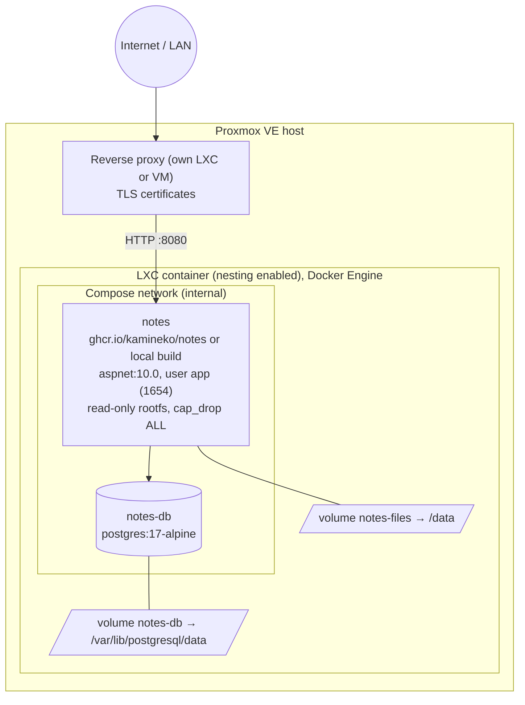
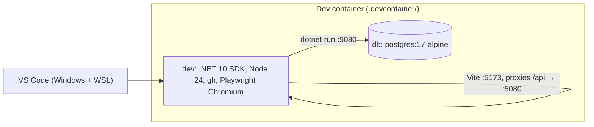

# 7. Deployment view

## Production: Docker Compose in a Proxmox LXC

| Element | Details |
| :--- | :--- |
| `notes` container | Multi-stage image from `docker/Dockerfile`: the client is built with Node 24, the backend published with the .NET 10 SDK, both copied into the ASP.NET Core 10 runtime image. Runs as the non-root `app` user; serves API and client on port 8080; `HEALTHCHECK` calls `/api/health` through the app's own `healthcheck` command. Base images are pinned by digest. |
| Hardening (compose) | `read_only: true`, a 64 MB `tmpfs` on `/tmp`, `cap_drop: [ALL]`, `no-new-privileges`. |
| `notes-db` container | PostgreSQL 17, only reachable inside the Compose network; data in the `notes-db` volume. |
| Configuration | `.env` (database password, first administrator, public URL, proxy trust, retention, upload limit) mapped to `Notes__*` settings in `docker-compose.yml`. |
| Reverse proxy | Terminates TLS. With `Notes__TrustProxy=true` the app trusts its `X-Forwarded-*` headers when it connects from `Notes__TrustedProxies` (default: private networks). |
| Backups | `pg_dump` of the database plus an archive of the `notes-files` volume, or a Proxmox backup of the whole LXC. |

Installation, proxy examples, updates, backup and restore: [deployment guide](../deployment.md).

## Development environment

`dotnet run --project backend/src/Notes.Api` uses the Development settings (demo account `demo@notes.test` / `demo-password`); `npm --prefix client run dev` serves the client with hot reload. The integration tests create one database per test class on the same Postgres.

## CI/CD (GitHub Actions)

| Workflow | Trigger | What it does |
| :--- | :--- | :--- |
| `ci.yml` | Pull requests, pushes to `main`, called by `release.yml` | Backend build (warnings as errors, locked restore) and tests against Postgres; client lint, unit tests, build; Playwright smoke tests against the real backend; NuGet and npm audit; dependency review on pull requests; Docker build, image vulnerability scan (Grype), Compose smoke test including the hardening. |
| `codeql.yml` | Pull requests, `main`, weekly | CodeQL `security-extended` for C#, TypeScript and the workflows. |
| `scorecard.yml` | `main`, weekly | OpenSSF Scorecard (supply-chain practices). |
| `release.yml` | Tags `v*` | CI, then a multi-arch image (amd64, arm64) to GHCR with BuildKit SBOM and provenance, a Sigstore-signed build provenance attestation, CycloneDX SBOMs of image and source, and a GitHub release with the SBOMs attached. |
| Dependabot | Weekly | NuGet, npm, Docker base images, the Compose Postgres image, GitHub Actions, dev container features. |
