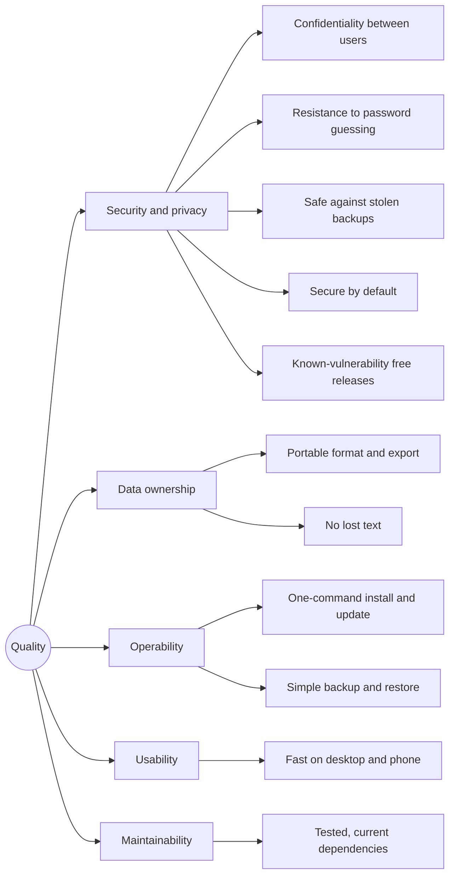

# 10. Quality requirements

## Quality tree

## Quality scenarios

| Id | Quality | Scenario | Expected response | Verified by |
| :--- | :--- | :--- | :--- | :--- |
| S1 | Confidentiality | A signed-in user requests another user's note, notebook, attachment or version by its id. | 404, exactly as for a missing id. | `NoteTests`, `ResourceAndUserTests` |
| S2 | Brute force | An attacker tries passwords for one account from many addresses. | After 10 failures in 15 minutes the account refuses sign-ins (429) until the window has passed; every attempt is logged. | `SecurityTests` |
| S3 | Stolen backup | Someone obtains a database dump. | They can't sign in with it: passwords are PBKDF2 hashes, sessions only token hashes. | Design review, `AuthTests` |
| S4 | CSRF | A foreign website makes the browser send a write request. | Refused (403) by the Origin check; the cookie isn't sent cross-site anyway. | `AuthTests` |
| S5 | XSS | A note or an uploaded SVG/HTML contains a script. | Sanitized or served as a download; the CSP would block it in any case. | `MarkdownRenderer` tests, `ResourceAndUserTests` |
| S6 | Secure defaults | A fresh installation with the shipped `docker-compose.yml`. | No default credentials, database not reachable from outside, container read-only without capabilities, demo account off. | CI Compose smoke test |
| S7 | Vulnerabilities | A dependency gets a published vulnerability. | CI fails (NuGet/npm audit, image scan) and Dependabot opens an update within a week. | CI |
| S8 | Reporting | A researcher finds a vulnerability. | Private report; targets (best effort): acknowledgement within 3 working days, fix for critical issues within 30 days, advisory. | [SECURITY.md](../../SECURITY.md) |
| D1 | Portability | A user wants to move to another app. | *Export notes* gives a ZIP of Markdown files with attachments and working links. | `ExportTests` |
| D2 | No lost text | The network drops or the note was changed on another device while typing. | The draft stays in the browser and is saved later; a conflict shows both versions; earlier states are in the history. | Client tests, `NoteTests`, `VersionTests` |
| O1 | Update | The administrator updates to a new release. | `docker compose pull && docker compose up -d` (or `--build`); migrations run on start. | Release process |
| O2 | Restore | The server is lost. | Restoring the database dump and the attachments archive brings back everything. | [Deployment guide](../deployment.md) |
| U1 | Speed | A user with 2,000 notes searches. | Results while typing (300 ms debounce, answer within a few hundred milliseconds). | Trigram indexes, manual tests |
| M1 | Regressions | A change breaks a flow. | CI fails before merge (backend, client and end-to-end tests). | CI |
